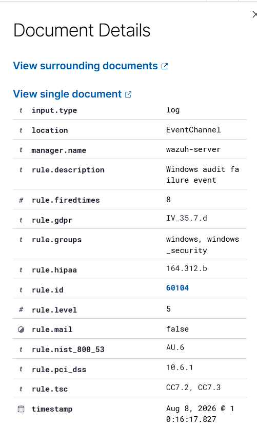
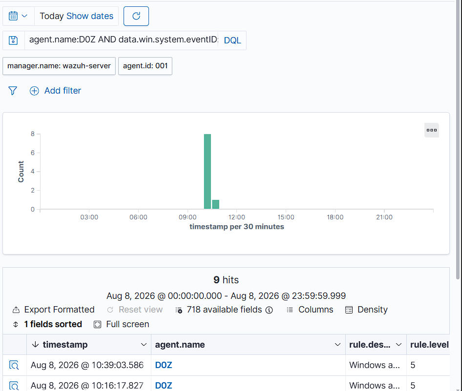

# Windows Endpoint Security Monitoring and Investigation

A Windows 11 endpoint connected to a Wazuh SIEM/XDR server, and an investigation of a recurring Windows Security event (Event ID 5061) using only the telemetry Wazuh collected.

| | |
|---|---|
| Platform | Wazuh SIEM/XDR 4.14.6 |
| Endpoint | Windows 11 with Wazuh agent |
| Events investigated | 8 August 2026 |
| Type | Independent lab project |

## Setup

One Windows 11 endpoint runs the Wazuh agent. The agent forwards Windows Security events to the Wazuh server, and the events are searched and investigated in the Wazuh dashboard.

```
Windows 11 endpoint (Wazuh agent)  ->  Wazuh manager  ->  Wazuh dashboard
```

The same endpoint was assessed against the CIS Windows 11 Benchmark in the companion project: [CIS Security Configuration Assessment](https://github.com/lixar0/wazuh-windows11-cis-sca-assessment).

## The alert

Wazuh raised rule **60104** ("Windows audit failure event") at **level 5**, in the `windows` and `windows_security` groups. The underlying record was Windows Security Event ID 5061, written by the Microsoft-Windows-Security-Auditing provider.

| Field | Observed value |
|---|---|
| Event ID | 5061 |
| Channel | Security |
| Provider | Microsoft-Windows-Security-Auditing |
| Algorithm | RSA |
| Key name | TB_0_Live.com / TB_0_Microsoft.com |
| Key type / Operation | %%2500 / %%2480 |
| Return code | 0x8009003a |
| Wazuh rule | 60104, level 5 |



## Method

1. **Identify the event.** Read the raw fields to learn what Windows recorded: provider, algorithm, key names and return code.
2. **Correlate the process.** Matched process ID 1464 to `lsass.exe`, the Local Security Authority Subsystem Service.
3. **Check recurrence.** Searched the day and found 9 matching events with the same process ID and return code, and different key names.
4. **Classify on evidence.** Decided what the telemetry supports and what it does not.



## Verdict

A repeating event tied to `lsass.exe` gives useful context. Proving an attack needs more evidence than this telemetry held, so I classified the activity as an observed Windows security event that needs further context, and did not raise it as an incident.

| Investigation aspect | Result |
|---|---|
| Event | Windows Security Event ID 5061 |
| Recurrence | 9 matching events |
| Process correlation | PID 1464 (lsass.exe) |
| Algorithm | RSA |
| Malicious activity confirmed | No |
| Incident confirmed | No |

## Limits and next steps

The lab has one Windows 11 endpoint and one Wazuh server, so it does not reflect the scale, alert volume or procedures of a production SOC. No attack simulation was run. The investigation covers only telemetry Wazuh collected during normal use.

Next steps:

- Add more endpoints to compare behaviour across machines.
- Add network monitoring and threat intelligence for richer context.
- Run controlled attack scenarios to test detection and triage under realistic conditions.

## Skills shown

SOC monitoring, alert triage, Windows Security event analysis, process correlation, recurrence analysis, evidence-based classification, security reporting.
